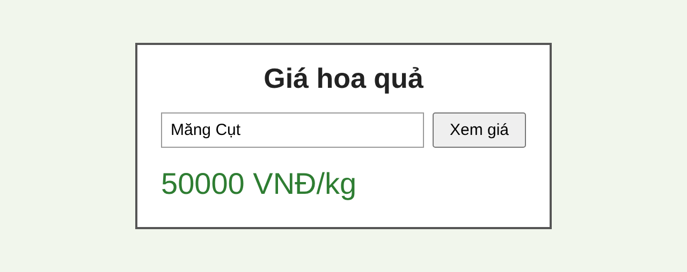

# Bài 3.2.2 – Tra cứu giá hoa quả

Bài tập JavaScript trong sách *Bài tập Thiết kế Web*, mục **3.2.2. Tra cứu giá hoa quả** (Hình 3.1).

## Kết quả



## Yêu cầu

Nhập tên một loại hoa quả, nhấn **Xem giá** để hiện giá tiền. Nếu loại hoa quả không có trong danh sách thì hiện **"Tìm không thấy"**.

| Hoa quả | Giá |
|---|---|
| Ổi | 20000 VNĐ/kg |
| Dưa Hấu | 20000 VNĐ/kg |
| Táo | 30000 VNĐ/kg |
| Cam | 40000 VNĐ/kg |
| Chôm Chôm | 40000 VNĐ/kg |
| Măng Cụt | 50000 VNĐ/kg |

## Cấu trúc

```
js-tra-cuu-gia-hoa-qua/
├── index.html       # khung "Giá hoa quả": ô nhập, nút Xem giá, kết quả
├── style.css
├── script.js        # hàm xemGia dùng switch – case
└── screenshot.png   # ảnh kết quả
```

## Kiến thức JavaScript sử dụng

- Lấy tên hoa quả nhập vào: `document.getElementById("ten_hoa_qua").value`
- Cấu trúc `switch … case`, **gộp nhiều `case`** cho các loại cùng giá (Ổi và Dưa Hấu; Cam và Chôm Chôm)
- Nhánh `default` cho loại không có trong danh sách
- Xử lý chuỗi: `trim()` bỏ khoảng trắng thừa, `toLowerCase()` để không phân biệt chữ hoa thường, `normalize("NFC")` để chữ có dấu gõ từ các bộ gõ khác nhau vẫn so sánh đúng
- Thẻ `<datalist>` gợi ý tên hoa quả khi gõ

## Ghi chú

Gõ chữ hoa (`MĂNG CỤT`) hoặc không dấu (`mang cut`) vẫn tra được giá.

## Cách chạy

Tải repo về (**Code → Download ZIP**), mở file `index.html` bằng trình duyệt, nhập tên hoa quả rồi bấm **Xem giá**.
